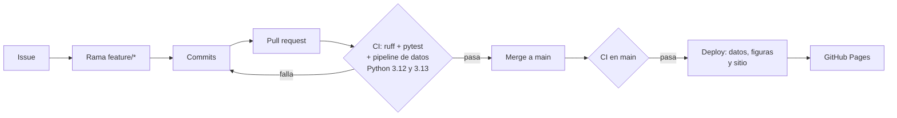

# EA2 · Flujo DevOps para el scraper del Samsung Galaxy A55

[](https://github.com/NeiderJPCuervo/EA2-DevOps-Scraping-GalaxyA55/actions/workflows/ci.yml)
[](https://github.com/NeiderJPCuervo/EA2-DevOps-Scraping-GalaxyA55/actions/workflows/deploy.yml)

**Tablero publicado:** https://neiderjpcuervo.github.io/EA2-DevOps-Scraping-GalaxyA55/

Evidencia de aprendizaje 2 de *Programación para Análisis de Datos*
(Ingeniería de Software y Datos, IU Digital). Autor: John Neider Cuervo Quintero.

El proyecto toma el scraper de la EA1, que extrae con **Selenium**, **BeautifulSoup**
y **Scrapy** los precios del Samsung Galaxy A55 en Mercado Libre Colombia, y lo pone
bajo un flujo DevOps:

- control de versiones con **Git** y **GitHub** (issues, ramas, pull requests,
  rama `main` protegida y releases);
- **integración continua** con GitHub Actions: lint, 36 pruebas automatizadas y
  ejecución completa del pipeline de datos en cada cambio;
- **despliegue continuo** del tablero de precios en **GitHub Pages** cada vez que
  un cambio validado llega a `main`.

## Flujo de trabajo



| Workflow | Disparador | Qué hace |
|---|---|---|
| [`ci.yml`](.github/workflows/ci.yml) | pull request y push a `main` | Instala dependencias con caché, `ruff check`, `pytest --cov`, BeautifulSoup + Scrapy + análisis fuera de línea, resumen y artefactos |
| [`deploy.yml`](.github/workflows/deploy.yml) | CI terminó con éxito en `main` (`workflow_run`) o manual | Regenera datos y figuras, construye `site/` y lo publica con `actions/deploy-pages` |

### ¿Por qué el CI no hace scraping en vivo?
Mercado Libre redirige a una verificación anti-bot (`/gz/account-verification`) las
peticiones que no vienen de un navegador real, y los servidores de GitHub tampoco
tienen sesión gráfica para Selenium. En vez de evadir esa protección, el pipeline
trabaja sobre el HTML que Selenium capturó en `data/raw/` (25 de octubre de 2026).
Así las ejecuciones son reproducibles, rápidas y no generan tráfico hacia el sitio.
La captura en vivo se hace a mano con `01_selenium_navegador.py`.

## Estructura

```
scraping/
  config.py               URL, selectores CSS, cortesía y rutas (EA2_SALIDA)
  parsers.py              limpieza y parseo compartidos
  01_selenium_navegador.py captura del listado y la ficha (navegador real)
  02_bs4_listado.py       requests + BeautifulSoup (--local usa data/raw/)
  ml_scrapy/              proyecto Scrapy: spider, item y pipeline de limpieza
  04_analisis.py          pandas + matplotlib → resumen.json y figuras
  06_sitio.py             tablero HTML para GitHub Pages
tests/                    pytest: unitarias, integración y regresión
data/raw/                 HTML capturado por Selenium (entrada de las pruebas)
.github/workflows/        ci.yml y deploy.yml
```

## Uso local

```bash
python3 -m venv .venv && source .venv/bin/activate
pip install -r requirements-dev.txt
ruff check .
pytest --cov
```

Pipeline completo sin conexión, escribiendo en `salida/` en lugar de `data/`:

```bash
export EA2_SALIDA=$PWD/salida
cd scraping
python 02_bs4_listado.py --local
(cd ml_scrapy && scrapy crawl galaxy_a55 -a origen=local)
python 04_analisis.py
python 06_sitio.py          # genera site/index.html
```

## Resultados del análisis

| Indicador | Valor |
|---|---|
| Publicaciones extraídas (3 páginas) | 119 |
| Publicaciones que son un Galaxy A55 | 30 |
| Precio mediano | $874.950 |
| Mediana nuevo (n=5) / usado (n=24) | $1.895.180 / $829.950 |
| Con envío gratis | 90 % |

## Ética del scraping
Se respeta `robots.txt` (`ROBOTSTXT_OBEY = True`), con 3 s entre peticiones, una conexión
y un User-Agent que identifica el proyecto como académico. No se evaden
verificaciones anti-bot y solo se recogen datos públicos de las publicaciones.

Consulte [CONTRIBUTING.md](CONTRIBUTING.md) para conocer el flujo de ramas y commits.
